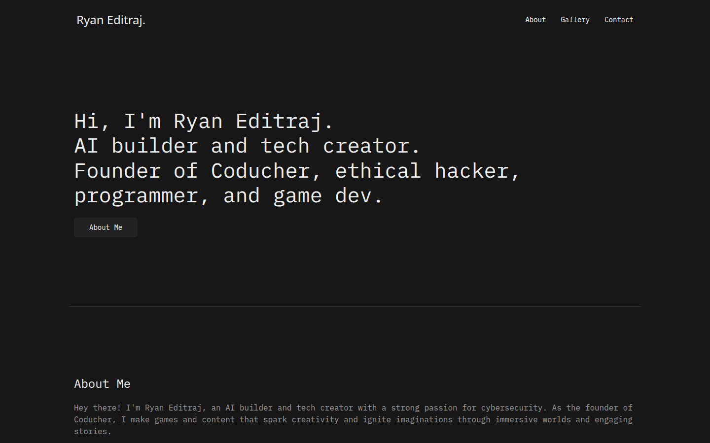
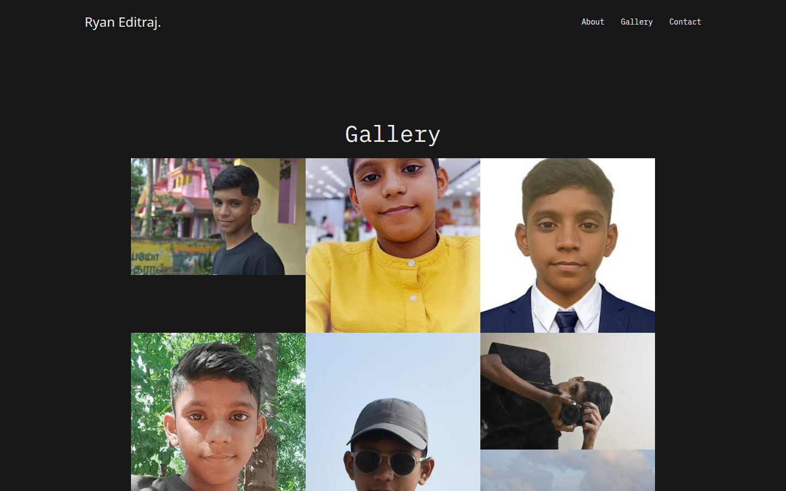
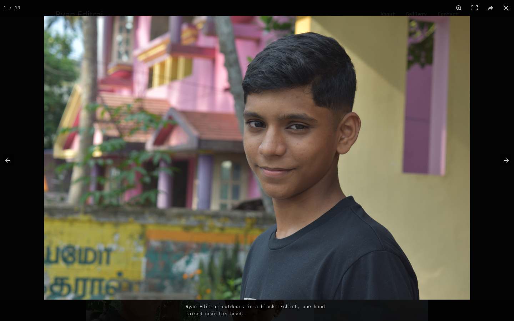
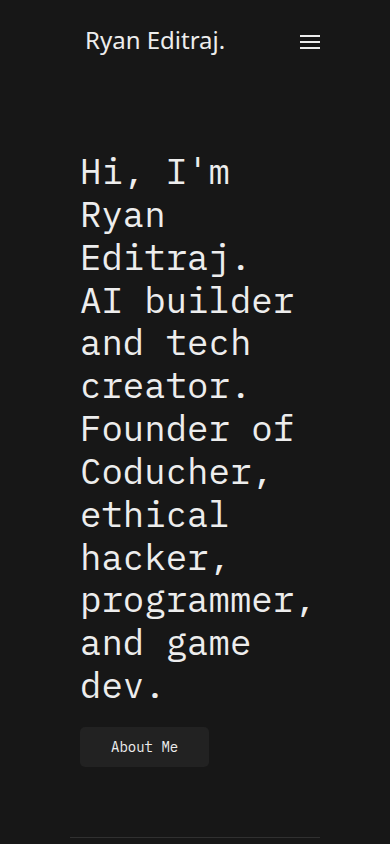

# Ryan Editraj

**The public portfolio of an AI builder and tech creator: a dark, static site you can read, fork, and run with one command.**

Ryan Editraj's homepage and photography gallery, published from this repository with GitHub Pages. The live site is [ryaneditraj.github.io](https://ryaneditraj.github.io).

[](LICENSE)
[](https://ryaneditraj.github.io)
[](https://getuikit.com)
[](package.json)

## Demo

Screenshots below were captured from a local run of this repository (`python3 -m http.server`). They are the real homepage, the photography grid, and the lightbox.

| Homepage | Gallery |
| --- | --- |
|  |  |





Open the live pages: [Home](https://ryaneditraj.github.io/) · [Gallery](https://ryaneditraj.github.io/gallery.html)

## Features

- Single-page introduction: who Ryan is, what Coducher is, and how to get in touch
- Photography gallery with a keyboard-friendly lightbox (zoom, fullscreen, previous, next)
- Compressed thumbnails in the grid, with the original photo still one click away
- Responsive layout: desktop nav and an off-canvas menu on small screens
- No build step, no API keys, and no third-party JavaScript
- Open-source community files: license, contributing guide, code of conduct, security policy, and CI

## Tech stack

| Piece | Role |
| --- | --- |
| HTML | Homepage, gallery, and 404 page |
| CSS | [UIkit 3.14.0](https://github.com/uikit/uikit) (MIT), locally themed, plus `css/styles.css` and `css/gallery.css` |
| JavaScript | UIkit for nav, scroll, and icons; [PhotoSwipe 4.1.0](vendor/photoswipe/README.md) (MIT) for the lightbox |
| Type | [IBM Plex Mono](fonts/OFL.txt), self-hosted under the SIL Open Font License |
| Hosting | GitHub Pages from the `main` branch |

PhotoSwipe is vendored under `vendor/photoswipe/` so the gallery does not depend on a CDN. UIkit is already in `css/` and `js/`.

## Quick start

You need Git and Python 3. Nothing is installed from npm.

```bash
git clone https://github.com/ryaneditraj/ryaneditraj.github.io.git
cd ryaneditraj.github.io
python3 -m http.server 8080
```

Then open http://localhost:8080.

`npm start` runs that same server if you prefer an npm script. `npm run check` runs the repository checks.

## Usage

- **About** scrolls to the bio on the homepage, and from the gallery it returns to `index.html#about`.
- **Gallery** opens the photo grid. Click a picture for the full-size file. Escape or the close button leaves the lightbox.
- **Contact** in the nav uses `mailto:`. The about section also links a public Gmail address.
- Social icons go to [Instagram](https://www.instagram.com/ryaneditraj), [GitHub](https://github.com/ryaneditraj), [LinkedIn](https://www.linkedin.com/in/ryaneditraj/), and [Twitter](https://twitter.com/ryaneditraj/).

There is no admin panel and no environment to configure. `.env.example` documents that on purpose.

## Project structure

```text
index.html              Homepage
gallery.html            Photography gallery
404.html                GitHub Pages 404
css/                    UIkit, site type, gallery grid
js/                     UIkit and the gallery lightbox
vendor/photoswipe/      Vendored PhotoSwipe 4.1.0 (MIT)
fonts/                  IBM Plex Mono (OFL)
assets/thumbs/          Grid thumbnails
docs/                   README screenshots and the social preview image
scripts/check_site.py   Local and CI checks
.github/                Issue forms, pull request template, CI
```

Full-size photos stay in the repository root so existing links keep working. The grid points at `assets/thumbs/` instead of downloading every original up front.

## Roadmap

- Put `ryaneditraj.tech` back on GitHub Pages (the `CNAME` file was removed, and that hostname no longer resolves)
- Add a projects section for Coducher, AI work, and games
- Generate smaller responsive image sizes than the current multi-megabyte originals
- Move the lightbox to PhotoSwipe 5 when the UI can stay the same
- Add a contact form that keeps credentials out of the repo
- Upgrade the customized UIkit bundle without losing the dark theme

## FAQ

### Who is Ryan Editraj?

Ryan Editraj is an AI builder and tech creator, and the founder of Coducher. This site introduces him as a programmer, ethical hacker, and game developer, and it hosts his photography. He is on [GitHub](https://github.com/ryaneditraj) and [Instagram](https://www.instagram.com/ryaneditraj) (about 295,000 followers).

### What is this repository?

It is the source of his personal portfolio and photo gallery. GitHub Pages serves the files in `main` at https://ryaneditraj.github.io.

### How do I run the portfolio locally?

Clone the repo and run `python3 -m http.server 8080`, then open http://localhost:8080. There is no install step.

### What technologies does the site use?

Hand-written HTML, UIkit 3.14 for layout and navigation, a small gallery script, and vendored PhotoSwipe 4.1.0. IBM Plex Mono is self-hosted. See the tech stack table above.

### Where is the live website?

https://ryaneditraj.github.io is the live homepage. https://ryaneditraj.github.io/gallery.html is the gallery. The previous custom domain, ryaneditraj.tech, is not wired up in this repo right now.

### How does the photo gallery work?

Each tile is a compressed thumbnail. The link target is the original image. `js/gallery.js` opens that original in PhotoSwipe and escapes the caption before it is shown. If JavaScript is off, the link still opens the original file.

### Does the site need API keys or a .env file?

No. `.env.example` is a placeholder for a future form or analytics key. Do not commit real secrets. A Google Maps key that used to live in an older homepage is gone from the working tree; see [SECURITY.md](SECURITY.md) if you need to rotate historical credentials.

### Is the project open source?

Yes. The code is [MIT](LICENSE). UIkit and PhotoSwipe are MIT. IBM Plex Mono is OFL. Gallery photographs are Ryan's pictures, included so the site can run. Credit him if you reuse a photo, and don't present the pictures as your own.

### How do I report a security problem?

Email . The disclosure policy is in [SECURITY.md](SECURITY.md). Please don't file a public issue for an unfixed vulnerability.

### How can I contribute?

Read [CONTRIBUTING.md](CONTRIBUTING.md). Bug fixes, docs, and accessibility improvements are the best place to start. The [code of conduct](CODE_OF_CONDUCT.md) is the Contributor Covenant 2.1.

## Contributing

See [CONTRIBUTING.md](CONTRIBUTING.md). Pull requests should keep the homepage and gallery usable and should pass `python3 scripts/check_site.py`.

## License

Source code is licensed under the [MIT License](LICENSE). Copyright 2024–2026 Ryan Editraj.

Third-party pieces keep their own licenses: UIkit (MIT, header in `css/uikit.css`), PhotoSwipe (MIT, `vendor/photoswipe/LICENSE`), IBM Plex Mono (SIL OFL, `fonts/OFL.txt`).

## Author

**Ryan Editraj** — AI builder and tech creator.

- GitHub: [github.com/ryaneditraj](https://github.com/ryaneditraj)
- Instagram: [instagram.com/ryaneditraj](https://instagram.com/ryaneditraj)
- Portfolio: [ryaneditraj.github.io](https://ryaneditraj.github.io)
- Email: [](mailto:)
